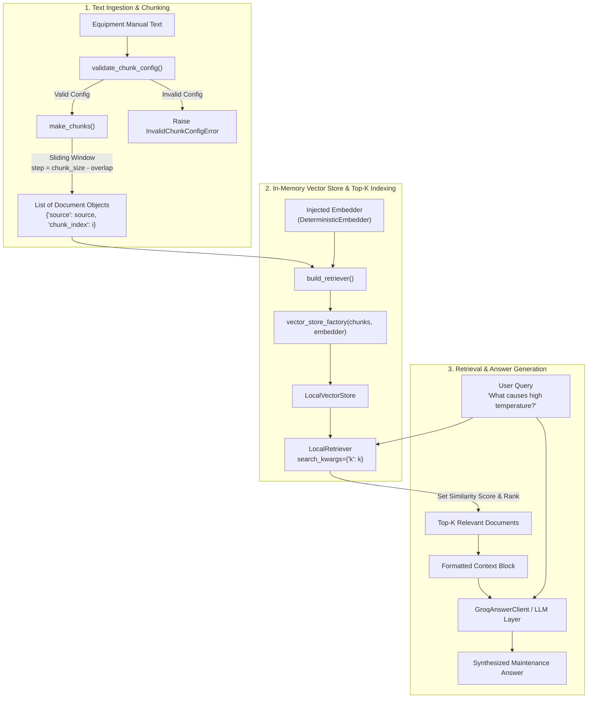

# Local Top-K Retriever

[](https://www.python.org/)
[](https://docs.pytest.org/)
[](https://groq.com/)
[](https://github.com/Shubhankart101/LocalTop-KRetriever)
[](LICENSE)

A lightweight, deterministic, offline-capable Retrieval-Augmented Generation (RAG) chunker and top-$k$ retriever built for maintenance assistants querying technical equipment manuals.

---

## 📌 Problem Overview

Maintenance and field service assistants require exact and reproducible access to technical equipment manuals (e.g., pressure thresholds, error codes, emergency shutdown sequences). Traditional RAG pipelines often suffer from:
1. **Non-deterministic Embeddings & Heavy Dependencies:** Requiring gigabytes of model downloads or cloud API dependencies just to run unit tests or deterministic verification.
2. **Boundary Distortion & Text Alteration:** Uncontrolled trimming, lowercasing, or character normalization that corrupts technical specifications, part numbers, or exact tabular layouts.
3. **Chunk Boundary Gaps:** Naive non-overlapping splits that split critical procedures across chunk boundaries, losing context between consecutive instructions.
4. **Off-by-One and Type Failures:** Permissive configuration validation allowing booleans, floating-point numbers, or inverted overlap ($overlap \ge chunk\_size$) to cause silent infinite loops or runtime crashes.

### Key Objectives
- **Strict Boundary & Type Validation:** Enforces non-boolean positive integers for `chunk_size` and $k$, with non-negative integer overlap strictly less than `chunk_size`.
- **Deterministic Overlapping Sliding Windows:** Reads exact `chunk_size` character windows and advances by `chunk_size - overlap` without trimming or mutating source text.
- **Traceable Document Metadata:** Assigns zero-indexed sequential indices and source tracking (`{"source": source, "chunk_index": index}`).
- **Pluggable Vector Store & Dependency Injection:** Connects chunked documents to an injected vector store factory and configures a top-$k$ retriever without downloading external embedding models.
- **Local & Offline Verification:** Runs completely in-memory with a deterministic set-intersection embedder while remaining 100% compatible with real Groq-backed LLM answer layers.

---

## 🏗️ Architecture & Data Flow



---

## ⚙️ Core Functions

### 1. `validate_chunk_config(chunk_size: int, overlap: int, k: int) -> None`
Enforces strict configuration rules before any chunking or retrieval operations take place:
- **`chunk_size`**: Must be a positive non-boolean integer (`chunk_size > 0`).
- **`k`**: Must be a positive non-boolean integer (`k > 0`).
- **`overlap`**: Must be a non-boolean integer satisfying $0 \le overlap < chunk\_size$.
- **Error Handling**: Raises `InvalidChunkConfigError` (subclass of `ValueError`) for any violation (e.g., `True`, `False`, floats, strings, negative values, or $overlap \ge chunk\_size$).

### 2. `make_chunks(text: str, source: str, chunk_size: int, overlap: int) -> list[Document]`
Splits source text into deterministic, ordered, overlapping chunks:
- Validates `chunk_size` and `overlap` using `validate_chunk_config`.
- Returns an empty list `[]` when `text` is empty.
- When `len(text) <= chunk_size`, produces exactly one chunk with `chunk_index: 0`.
- For longer texts, slides a character window of length `chunk_size`, advancing by `step = chunk_size - overlap` characters per iteration until the start index reaches `len(text)`.
- **Character Preservation**: Preserves exact whitespace, newlines, tabs, and punctuation verbatim (no trimming, stripping, or casing changes).
- **Metadata**: Every chunk is packaged into a frozen `Document` dataclass with metadata:
  ```python
  {"source": source, "chunk_index": index}
  ```

### 3. `build_retriever(chunks: Sequence[Document], embedder, vector_store_factory, k: int)`
Wires the document chunks and deterministic embedder to the local vector store:
- Validates that $k$ is a valid positive non-boolean integer.
- Forwards `chunks` and `embedder` directly into `vector_store_factory(chunks, embedder)`.
- Invokes `store.as_retriever(search_kwargs={"k": k})` and returns the resulting retriever instance.
- No external model downloads or vector math libraries required.

---

## 🧮 Sliding Window Chunking Mechanics

The chunking algorithm calculates the sliding stride step as:
$$\text{step} = \text{chunk\_size} - \text{overlap}$$

### Example Walkthrough
Given:
- `text = "ABCDEFGHIJ"` (length 10)
- `chunk_size = 4`
- `overlap = 1`
- `step = 4 - 1 = 3`

| Window Index | Start Position | Slice Range `[start : start + chunk_size]` | Chunk Content | Chunk Index |
|:---:|:---:|:---:|:---:|:---:|
| 0 | 0 | `text[0:4]` | `"ABCD"` | 0 |
| 1 | 3 | `text[3:7]` | `"DEFG"` | 1 |
| 2 | 6 | `text[6:10]` | `"GHIJ"` | 2 |
| 3 | 9 | `text[9:13]` (bounded to text length) | `"J"` | 3 |
| Terminate | 12 | $12 \ge \text{len}(text)$ | Loop Ends | - |

**Resulting Chunks:** `["ABCD", "DEFG", "GHIJ", "J"]`

---

## 📂 Repository Structure

```
LocalTop-KRetriever/
├── .gitignore               # Git ignore patterns for Python, pytest, and caches
├── LICENSE                  # MIT License
├── README.md                # Detailed project documentation and architecture guide
├── main.py                  # Core implementations: validate_chunk_config, make_chunks, build_retriever
├── pytest.ini               # Pytest configuration with pythonpath set to root
├── requirements.txt         # Core dependencies (pytest==8.4.1, groq==1.7.0)
├── tests/
│   └── test_retriever.py    # Unit & integration test suite covering boundary cases
└── utils/
    ├── __init__.py          # Module docstring
    ├── assistant.py         # Groq LLM integration and answer_with_retrieval pipeline
    └── retrieval.py         # Document dataclass, DeterministicEmbedder, LocalVectorStore, LocalRetriever
```

---

## 🚀 Quickstart

### Prerequisites
- Python 3.10 or higher
- Git

### Installation
Clone the repository and install dependencies:
```bash
git clone https://github.com/Shubhankart101/LocalTop-KRetriever.git
cd LocalTop-KRetriever
pip install -r requirements.txt
```

### Basic Usage Example
```python
from main import validate_chunk_config, make_chunks, build_retriever
from utils.retrieval import DeterministicEmbedder, local_vector_store_factory

# 1. Define configuration
chunk_size = 50
overlap = 10
k = 2
validate_chunk_config(chunk_size, overlap, k)

# 2. Prepare manual text and generate chunks
manual_text = (
    "INDUSTRIAL TURBINE T-900 MANUAL\n"
    "Section 1: Operating pressure must stay within 40-60 PSI.\n"
    "Section 2: High vibration shutdown triggers at 5.5 mm/s.\n"
    "Section 3: Lubricant filter replacement cycle is 500 operating hours.\n"
)
chunks = make_chunks(
    text=manual_text,
    source="turbine_manual.txt",
    chunk_size=chunk_size,
    overlap=overlap,
)

# 3. Build top-k retriever
embedder = DeterministicEmbedder()
retriever = build_retriever(
    chunks=chunks,
    embedder=embedder,
    vector_store_factory=local_vector_store_factory,
    k=k,
)

# 4. Query the retriever
relevant_docs = retriever.invoke("vibration shutdown")
for doc in relevant_docs:
    print(f"Chunk #{doc.metadata['chunk_index']} ({doc.metadata['source']}):")
    print(doc.page_content)
    print("-" * 40)
```

---

## 🧪 Running Tests

Execute the comprehensive unit and integration test suite:
```bash
pytest -v
```

### Test Coverage Highlights:
- **Type Safety & Bounds:** Rejection of booleans (`True`, `False`), non-integer types (`float`, `str`, `None`, lists), non-positive integers, and inverted overlap configurations.
- **Edge Boundaries:** Empty source text, sources shorter than `chunk_size`, sources equal to `chunk_size`, and multi-window overlap stepping.
- **Character Invariance:** Verifies whitespace, newlines, and symbols are never altered or stripped.
- **Dependency Forwarding:** Confirms exact embedder and chunk dependencies are forwarded to `vector_store_factory` without side-effects.
- **End-to-End Answering:** Validates integration with `LocalVectorStore` and mocked `GroqAnswerClient`.

---

## 📄 License

This project is licensed under the MIT License. See the [LICENSE](LICENSE) file for details.
